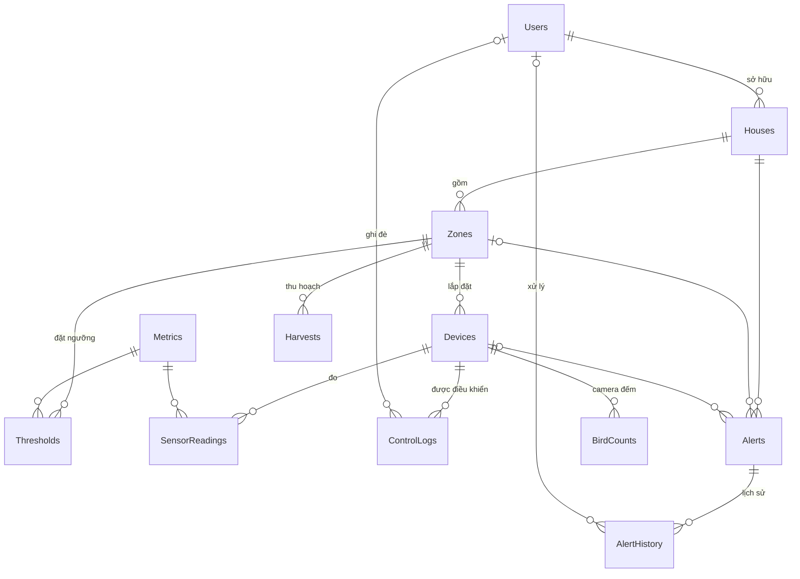

# SwiftletCare — database-core: thiết kế CSDL SQL Server

- **Ngày:** 2026-10-12
- **Trạng thái:** Đang thiết kế (duyệt từng phần)
- **Chủ module:** TV1
- **Nguồn:** [Roadmap](2026-10-12-swiftletcare-roadmap.md) · [Project.md](../../../Project.md)

## Phần 1 — Phạm vi, cấu trúc, môi trường, quy ước (đã duyệt)

### Phạm vi

Các mục 1–11 của `database-core` trong roadmap, giữ nguyên thứ tự ưu tiên và ranh giới cắt. Phân quyền SQL Server, demo transaction/đồng thời, sao lưu/phục hồi, tối ưu truy vấn và script sinh dữ liệu lớn thuộc `database-advanced`, không nằm trong spec này.

### Cấu trúc thư mục

Package `database/` riêng ở gốc repo, TV1 làm chủ. TV1 làm được ngay tuần 1 mà không phụ thuộc khung NestJS của TV2.

```
database/
  prisma/schema.prisma        # nơi duy nhất định nghĩa bảng
  prisma/migrations/          # migration Prisma + SQL viết tay (CHECK, clustered, ...)
  sql/
    01-views/
    02-functions-procs/
    03-triggers/              # CREATE OR ALTER, chạy lại an toàn
    seed/                     # dữ liệu mẫu cố định
  tests/                      # script kiểm thử T-SQL
  scripts/deploy.ps1          # migrate deploy → sql/ theo thứ tự → seed
  .env.example                # mẫu chuỗi kết nối; .env thật không commit
```

- Backend dùng chung schema: `prisma generate --schema ../database/prisma/schema.prisma`.
- `.env` (chuỗi kết nối, mật khẩu) nằm trong `.gitignore`; chỉ commit `.env.example`.

### Công cụ cần cài trên máy mọi thành viên

| Công cụ | Ghi chú |
|---|---|
| SQL Server 2025 Express | Bật Mixed Mode, TCP/IP cổng 1433 |
| `sqlcmd` | Chạy script SQL và test |
| Node.js 25 | Prisma CLI, `npm test` |
| PowerShell | Chạy `scripts/deploy.ps1` |

Cả 5 thành viên dùng Windows → chỉ cần `scripts/deploy.ps1`, không làm `deploy.sh`.

### Checklist thiết lập môi trường

1. Bật **Mixed Mode** (SQL Server + Windows authentication), khởi động lại dịch vụ SQL Server.
2. Bật **TCP/IP**, đặt cổng cố định **1433** trong SQL Server Configuration Manager (Express tắt TCP/IP mặc định), khởi động lại dịch vụ.
3. Tạo login SQL `swiftlet_dev`, là `db_owner` của CSDL `SwiftletCare` và có server role **`dbcreator`** — `prisma migrate dev` cần tạo **shadow database**. (Thay thế: khai báo `shadowDatabaseUrl` trỏ tới một CSDL shadow tạo sẵn.)
4. Sao chép `.env.example` → `.env`, điền mật khẩu.
5. Kiểm tra: `sqlcmd -S localhost,1433 -U swiftlet_dev -Q "SELECT @@VERSION"` trả về phiên bản.

**Vì sao dùng SQL login:** mỗi thành viên có máy và tài khoản Windows riêng; SQL login cho cả nhóm dùng chung một dạng chuỗi kết nối, đồng nhất giữa các máy. `swiftlet_dev` chỉ dùng khi phát triển; `database-advanced` thay bằng các login quyền tối thiểu.

### Kiểm thử SP

- Script T-SQL thuần, không dùng tSQLt (cần bật CLR, cài thêm framework).
- Mỗi SP một file trong `tests/`: chuẩn bị dữ liệu → `EXEC` → so kết quả, sai thì `THROW`.
- Mỗi file bắt đầu bằng `SET XACT_ABORT ON`, chạy trong `BEGIN TRAN … ROLLBACK`, bọc `TRY/CATCH` để **luôn ROLLBACK** kể cả khi test lỗi; không làm bẩn dữ liệu mẫu.
- `npm test` gọi `sqlcmd -b` cho từng file: lỗi trả mã thoát khác 0, `npm test` thất bại.

### Dữ liệu mẫu

- **Cố định, không ngẫu nhiên**: mọi máy chạy seed ra cùng dữ liệu, test và demo cho cùng kết quả.
- Script sinh vài triệu dòng cho phần tối ưu là riêng, thuộc `database-advanced`.

### Quy ước

- Thời gian: `DATETIME2(0)` lưu UTC; mặc định `@default(dbgenerated("sysutcdatetime()"))`; SP/trigger dùng `SYSUTCDATETIME()`. JSON dùng ISO 8601 có hậu tố `Z`.
- SP nhận JSON qua `OPENJSON` (không TVP); backend gọi bằng `$queryRaw`/`$executeRaw` có tham số.
- **Mỗi SP trả đúng 1 tập kết quả.**
- Lỗi nghiệp vụ: `THROW` mã 5xxxx; backend đổi sang HTTP 400/409.
- Bảng có trigger (`Alerts`, `Devices`) chỉ được **ghi** qua SP.
- Miền giá trị bằng ràng buộc `CHECK` viết tay trong file migration (`prisma migrate dev --create-only` → thêm SQL → áp dụng).
- Khóa ngoại `NO ACTION`; ngừng dùng bằng `IsActive = 0`, không xóa.

### Mốc 20/10

Migration bảng lõi + `sp_IngestReadings` + `sp_SetActuator` + test của hai SP chạy được bằng `scripts/deploy.ps1` và `npm test` trên máy sạch.

## Phần 2 — ERD và các bảng (đã duyệt)



### Kiểu khóa: INT hay BIGINT

Prisma trả cột `BIGINT` về JS dạng `BigInt`, `JSON.stringify` sẽ lỗi. Quy ước:

- Khóa lộ ra qua API/WebSocket dùng **INT**.
- **BIGINT chỉ cho bảng rất lớn** và không lộ ra API. Nếu buộc phải trả ra, backend chuyển sang chuỗi.
- Cột kết quả SP dùng INT (`COUNT`, không `COUNT_BIG`).

Rà soát: chỉ **`SensorReadings.ReadingId`** là BIGINT, không lộ ra API (lịch sử trả số tổng hợp, `vw_LatestReadings` không chọn cột này). `ControlLogs.LogId`, `AlertHistory.HistoryId`, `BirdCounts.CountId` dùng INT: lượng dữ liệu nhỏ (nhật ký chỉ ghi khi trạng thái đổi; đếm chim 288 cửa sổ/ngày/camera) và có thể lộ ra API.

### Bảng lõi (mục 1, xong 20/10)

| Bảng | Cột chính (kiểu) | Ràng buộc |
|---|---|---|
| **Users** | UserId INT, Username VARCHAR(50), PasswordHash VARCHAR(255) (bcrypt, backend băm), FullName NVARCHAR(100), Email VARCHAR(255), Phone VARCHAR(20)?, Role VARCHAR(10), IsActive, CreatedAt | UQ Username, UQ Email; CK Role ∈ {ADMIN, OWNER} |
| **Houses** | HouseId INT, OwnerId→Users, Name NVARCHAR(100), Address NVARCHAR(255)?, IsActive, CreatedAt | UQ(OwnerId, Name) |
| **Zones** | ZoneId INT, HouseId→Houses, Name NVARCHAR(50), FloorNo TINYINT | UQ(HouseId, Name); **UQ(ZoneId, HouseId)** (đích của khóa ngoại ghép từ Alerts); FloorNo 0 = lối vào (nơi đặt camera) |
| **Devices** | DeviceId INT, ZoneId→Zones, Code VARCHAR(50), Name NVARCHAR(100), DeviceType VARCHAR(10), Status VARCHAR(10) (mặc định OFFLINE), LastSeenAt?, Mode VARCHAR(6)?, IsOn BIT?, Level TINYINT?, IsActive, CreatedAt | UQ Code (= MQTT client id, dạng `H1-F2-FAN`); CK DeviceType ∈ {SENSOR, MIST, FAN, HEATER, SPEAKER, CAMERA}; CK Status ∈ {ONLINE, OFFLINE, ERROR}; **CK Mode ∈ {AUTO, MANUAL}**; CK cơ cấu chấp hành (MIST/FAN/HEATER/SPEAKER) ⇒ Mode, IsOn NOT NULL; SENSOR/CAMERA ⇒ Mode, IsOn, Level đều NULL; CK Level 0–100 |
| **Metrics** | MetricCode VARCHAR(10) PK, Name NVARCHAR(50), Unit NVARCHAR(10), ValidMin, ValidMax DECIMAL(9,2) | Bảng tra: TEMP, HUMID, CO2, LIGHT; CK ValidMin < ValidMax; khoảng hợp lệ dùng lọc dữ liệu hỏng khi thu nhận |
| **Thresholds** | PK(ZoneId, MetricCode), MinValue?, MaxValue?, TargetValue? DECIMAL(9,2), UpdatedBy?→Users, UpdatedAt | CK có ít nhất Min hoặc Max; CK Min < Max; CK Target ∈ [Min, Max] |
| **SensorReadings** | ReadingId BIGINT, DeviceId, MetricCode, Value DECIMAL(9,2), RecordedAt | **UQ(DeviceId, MetricCode, RecordedAt)** chống bản ghi trùng do MQTT giao lại (QoS 1 giao ít nhất một lần); `sp_IngestReadings` bỏ qua dòng trùng bằng `NOT EXISTS`, không báo lỗi. Clustered/nonclustered: Phần 4 |
| **ControlLogs** | LogId INT, DeviceId, IsOn BIT, Level TINYINT?, Mode VARCHAR(6), Source VARCHAR(6), UserId?, Reason NVARCHAR(200)?, CreatedAt | **CK Mode ∈ {AUTO, MANUAL}**; CK Source ∈ {AUTO, MANUAL}; MANUAL ⇒ UserId NOT NULL |
| **Alerts** | AlertId INT, HouseId, ZoneId?, DeviceId?, AlertType, Severity, MetricCode?, Value?, DetectedClass?, Confidence?, SnapshotPath?, Message NVARCHAR(500), Status, CreatedAt, ResolvedAt?, ResolvedBy? | Xem bên dưới |
| **AlertHistory** | HistoryId INT, AlertId, OldStatus?, NewStatus, UserId?, Note NVARCHAR(500)?, ChangedAt | Do trigger ghi; UserId NULL = hệ thống |

**Ràng buộc trên Alerts**

- CK AlertType ∈ {THRESHOLD, PREDATOR, DEVICE_OFFLINE, POPULATION_DROP}; Severity ∈ {INFO, WARNING, CRITICAL}; Status ∈ {NEW, ACK, RESOLVED}; RESOLVED ⇔ ResolvedAt NOT NULL.
- Theo loại:

| AlertType | Bắt buộc có | Bắt buộc NULL |
|---|---|---|
| THRESHOLD | ZoneId, MetricCode, Value | DetectedClass, Confidence, SnapshotPath |
| PREDATOR | DeviceId, ZoneId, DetectedClass ∈ {rat, snake, owl}, Confidence ∈ [0,1], SnapshotPath | MetricCode, Value |
| DEVICE_OFFLINE | DeviceId, ZoneId | MetricCode, Value, DetectedClass, Confidence, SnapshotPath |
| POPULATION_DROP | — | **ZoneId, DeviceId**, MetricCode, Value, DetectedClass, Confidence, SnapshotPath |

- Cảnh báo gắn thiết bị (PREDATOR, DEVICE_OFFLINE) lưu ZoneId = khu vực của thiết bị (SP điền), để lọc theo khu vực được.
- **Khóa ngoại ghép `Alerts(ZoneId, HouseId) → Zones(ZoneId, HouseId)`**: CSDL tự đảm bảo HouseId khớp ZoneId. Khi ZoneId NULL (POPULATION_DROP), SQL Server không kiểm khóa ngoại ghép — đúng ý muốn. Khóa ngoại `Alerts(HouseId) → Houses` vẫn giữ. Phụ thuộc R5.
- **Chống mở trùng cảnh báo ngưỡng** khi hai lô số đo đến cùng lúc — dùng cả hai lớp:
  1. **Cơ chế chính:** `sp_IngestReadings` đọc cảnh báo đang mở với `UPDLOCK, HOLDLOCK`, duyệt các cặp (ZoneId, MetricCode) theo thứ tự cố định để tránh deadlock giữa hai lô.
  2. **Lưới an toàn ở tầng CSDL:** chỉ mục unique có lọc `UX_Alerts_OpenThreshold ON Alerts(ZoneId, MetricCode) WHERE AlertType = 'THRESHOLD' AND Status <> 'RESOLVED'`, viết tay trong migration (phụ thuộc R2). Bộ lọc **phải có `AlertType = 'THRESHOLD'`**: chỉ mục unique coi các NULL là bằng nhau, thiếu điều kiện này thì các cảnh báo có MetricCode NULL (thiên địch, giảm đàn…) chặn lẫn nhau. Chỉ mục này cũng phục vụ truy vấn dò cảnh báo đang mở.
  - Vì sao không chỉ dùng một lớp: chỉ có chỉ mục thì va chạm gây lỗi 2601, với `XACT_ABORT` sẽ hủy cả lô số đo; chỉ có khóa thì không chặn được ghi vòng qua SP.

### Bắt buộc, trên ranh giới cắt (mục 6)

- **BirdCounts**: CountId INT, CameraId→Devices, WindowStart DATETIME2(0), InCount INT, OutCount INT.
  - UQ(CameraId, WindowStart); CK số đếm ≥ 0.
  - CK WindowStart đúng mốc 5 phút: `DATEPART(MINUTE, WindowStart) % 5 = 0 AND DATEPART(SECOND, WindowStart) = 0`.
  - "CameraId là thiết bị CAMERA" không viết được bằng CHECK (cần đọc bảng khác) → SP kiểm tra.
  - Chỉ lưu số tổng hợp theo cửa sổ 5 phút, không lưu video.

### Dưới ranh giới cắt (mục 10)

- **Harvests**: HarvestId INT, ZoneId→Zones, HarvestDate **DATE**, NestCount INT, WeightGram DECIMAL(9,1), Grade CHAR(1)?, RecordedBy→Users, CreatedAt.
  - UQ(ZoneId, HarvestDate); CK Grade ∈ {A, B, C}; CK NestCount, WeightGram ≥ 0.
  - **HarvestDate là ngày theo giờ Việt Nam** — ngày nghiệp vụ do người nhập, không phải mốc thời gian; ngoại lệ có chủ ý của quy ước UTC.

### Nên có

- **NestLogs**: PK(ZoneId, WeekStart DATE — thứ Hai, giờ Việt Nam), ActiveNests INT, NewNests INT, Note NVARCHAR(500)?.

### Đã loại (YAGNI)

Vai trò STAFF và bảng thành viên nhà; tọa độ nhà yến; bảng lưu thông báo đã gửi; bảng phiên đăng nhập (dùng JWT); lưu video.

### Quyết định thiết kế

1. **`Alerts.HouseId` dư thừa có chủ ý** (không đạt 3NF chặt khi đã có ZoneId): cảnh báo giảm đàn là cấp nhà, không có khu vực; mọi truy vấn cảnh báo lọc theo nhà. Tính nhất quán do **khóa ngoại ghép** đảm bảo, không phụ thuộc SP. Ghi vào báo cáo như một đánh đổi.
2. **Alerts là một bảng chung**, cột riêng từng loại ràng buộc bằng CHECK theo AlertType; không tách bảng con vì 4 loại chung vòng đời NEW → ACK → RESOLVED và chung màn hình.
3. **Khóa ngoại `NO ACTION`**: giữ lịch sử, tránh lỗi "multiple cascade paths".
4. **Quyền sở hữu** theo chuỗi `Devices → Zones → Houses.OwnerId`; backend kiểm tra OWNER trước khi gọi SP, SP không kiểm tra quyền.

## Rủi ro cần kiểm chứng

Kiểm chứng ở bước lập kế hoạch, trước khi triển khai phần liên quan.

| # | Rủi ro | Cách kiểm | Nếu xảy ra |
|---|---|---|---|
| R2 | Chỉ mục lọc (`UX_Alerts_OpenThreshold`) và SQL viết tay khác trong migration bị `prisma migrate dev` coi là lệch (drift) so với schema. | Thêm chỉ mục lọc vào migration, chạy lại `prisma migrate dev`, xem có đòi reset hoặc sinh lệnh xóa không. | Đưa phần đó ra file `.sql` chạy sau migrate, ghi rõ ngoại lệ. |
| R5 | Prisma không chấp nhận quan hệ ghép `Alerts(ZoneId, HouseId) → Zones(ZoneId, HouseId)` có một cột tùy chọn (ZoneId) và một cột bắt buộc (HouseId), hoặc dùng chung cột HouseId với quan hệ tới Houses. | Khai báo quan hệ trong `schema.prisma`, chạy `prisma validate` và `prisma migrate dev --create-only`, xem SQL sinh ra. | Viết khóa ngoại ghép bằng SQL tay trong migration (theo cơ chế Phần 1); nếu tiếp tục lệch theo R2 thì xử lý như R2. |
