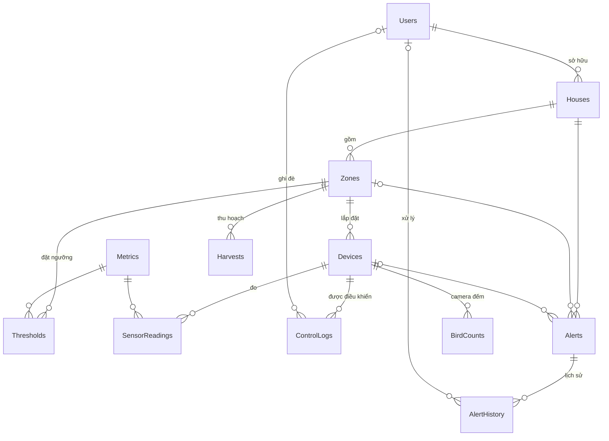

# SwiftletCare — Thiết kế CSDL SQL Server & hợp đồng tích hợp

- **Ngày:** 2026-10-12
- **Trạng thái:** Đang thiết kế (duyệt từng phần)
- **Nguồn yêu cầu:** [Project.md](../../../Project.md)

## Bối cảnh & mục tiêu

- Đề tài môn Hệ quản trị CSDL. Thầy chấm toàn bộ hệ thống: cả 6 nhiệm vụ phải demo end-to-end; phần SQL Server (thiết kế, SP, trigger, chỉ mục, phân quyền) được đầu tư sâu hơn.
- Nhóm 5 người, hạn 4 tuần (≈ 09/11/2026). Spec này chốt CSDL và các hợp đồng tích hợp sớm để các thành viên làm song song.
- Chức năng chia 3 mức: **Bắt buộc / Nên có / Nếu còn thời gian**. Trễ hạn thì cắt từ mức thấp nhất, không cắt nguyên một nhiệm vụ.
- Môi trường: SQL Server 2025 Express (hiện chỉ bật Windows authentication), Node 25, Python 3.13; chưa có Docker/Mosquitto.

## Phần 1 — Phân bổ logic & ranh giới Prisma / file .sql (đã duyệt)

### Phân bổ logic (phương án C — kết hợp)

| Việc | Đặt ở | Mức |
|---|---|---|
| Thu nhận lô dữ liệu cảm biến + mở/đóng cảnh báo ngưỡng trong 1 transaction | SP | Bắt buộc |
| Ghi đè thủ công: ghi trạng thái thiết bị + nhật ký điều khiển | SP | Bắt buộc |
| Ghi lịch sử cảnh báo | Trigger | Bắt buộc |
| Vài view báo cáo | View | Bắt buộc |
| Chỉ mục cho bảng SensorReadings | Prisma schema | Bắt buộc |
| Phân quyền | File .sql | Bắt buộc |
| Đếm chim theo cửa sổ thời gian | SP | Nên có |
| Chống báo trùng cảnh báo thiên địch | SP | Nên có |
| Sao lưu / phục hồi | File .sql | Nên có |
| Chỉ mục lọc | Migration viết tay | Nếu còn thời gian |
| Phân vùng bảng | Migration viết tay | Nếu còn thời gian |
| CRUD nhà, khu vực, thiết bị, người dùng, ngưỡng | Prisma | — |
| Vòng điều khiển PID, publish MQTT, WebSocket, gửi thông báo | Backend NestJS (không viết bằng T-SQL) | — |

### Nguồn định nghĩa schema

- **Bảng chỉ do Prisma schema định nghĩa và migrate** (một nơi duy nhất).
- Phần Prisma không biểu diễn được (ràng buộc CHECK, chỉ mục có INCLUDE, chỉ mục lọc, tạo bảng trên partition scheme) được **viết tay vào chính file migration**: `prisma migrate dev --create-only` → thêm SQL vào cuối `migration.sql` → áp dụng. Mọi DDL của bảng nằm trong `prisma/migrations/`, có phiên bản.
- Prisma không hỗ trợ enum trên SQL Server → các miền giá trị (Role, DeviceType, Status, AlertType, …) dùng ràng buộc CHECK theo cách trên.
- File `.sql` riêng chỉ chứa: SP, trigger, view, phân quyền, dữ liệu mẫu. Viết dạng `CREATE OR ALTER` để chạy lại an toàn.
- **Thứ tự triển khai:** `prisma migrate deploy` → các file `.sql` (view/SP/trigger, phân quyền) → dữ liệu mẫu.

### Gọi SP từ Prisma

- Không dùng TVP (Prisma không truyền được). SP nhận chuỗi JSON và đọc bằng `OPENJSON`:
  ```sql
  EXEC dbo.sp_IngestReadings @Json = N'[{"device":"H1-F1-SENSOR","metric":"TEMP","value":28.5,"at":"2026-10-12T10:40:00Z"}]';
  -- trong SP: SELECT ... FROM OPENJSON(@Json) WITH (device VARCHAR(50), metric VARCHAR(10), value DECIMAL(9,2), at DATETIME2(0))
  ```
- Backend gọi bằng `` prisma.$queryRaw`EXEC dbo.sp_IngestReadings @Json = ${JSON.stringify(batch)}` `` (tham số hóa, không nối chuỗi) hoặc `$executeRaw` khi không cần kết quả.
- **Quy ước:** mỗi SP trả về **tối đa một** tập kết quả.

## Phần 2 — ERD & danh sách bảng (đã duyệt)



### Bắt buộc (10 bảng)

| Bảng | Cột | Ràng buộc |
|---|---|---|
| **Users** | UserId, Username, PasswordHash, FullName, Email, Phone?, Role, IsActive, CreatedAt | UQ Username, UQ Email; CK Role ∈ {ADMIN, OWNER} |
| **Houses** | HouseId, OwnerId→Users, Name, Address?, IsActive, CreatedAt | UQ(OwnerId, Name) |
| **Zones** | ZoneId, HouseId→Houses, Name, FloorNo | UQ(HouseId, Name); FloorNo 0 = lối vào |
| **Devices** | DeviceId, ZoneId→Zones, Code, Name, DeviceType, Status, LastSeenAt?, Mode?, IsOn?, Level?, IsActive, CreatedAt | UQ Code (= MQTT client id); CK DeviceType ∈ {SENSOR, MIST, FAN, HEATER, SPEAKER, CAMERA}; CK Status ∈ {ONLINE, OFFLINE, ERROR}; CK Mode ∈ {AUTO, MANUAL}; CK Level 0–100; CK chỉ cơ cấu chấp hành (MIST/FAN/HEATER/SPEAKER) mới có Mode/IsOn, SENSOR/CAMERA thì Mode/IsOn/Level đều NULL |
| **Metrics** | MetricCode (PK), Name, Unit, ValidMin, ValidMax | Bảng tra: TEMP, HUMID, CO2, LIGHT; CK ValidMin < ValidMax; khoảng hợp lệ dùng lọc dữ liệu hỏng khi thu nhận |
| **Thresholds** | PK(ZoneId, MetricCode), MinValue?, MaxValue?, TargetValue?, UpdatedBy?→Users, UpdatedAt | CK có ít nhất một ngưỡng; CK Min < Max; CK Target ∈ [Min, Max] |
| **SensorReadings** | ReadingId (BIGINT), DeviceId, MetricCode, Value DECIMAL(9,2), RecordedAt | Xem chỉ mục bên dưới |
| **ControlLogs** | LogId, DeviceId, IsOn, Level?, Mode, Source, UserId?, Reason?, CreatedAt | CK Source ∈ {AUTO, MANUAL}; MANUAL ⇒ UserId NOT NULL |
| **Alerts** | AlertId, HouseId, ZoneId?, DeviceId?, AlertType, Severity, MetricCode?, Value?, DetectedClass?, Confidence?, SnapshotPath?, Message, Status, CreatedAt, ResolvedAt?, ResolvedBy? | CK AlertType ∈ {THRESHOLD, PREDATOR, DEVICE_OFFLINE, POPULATION_DROP}; CK Severity ∈ {INFO, WARNING, CRITICAL}; CK Status ∈ {NEW, ACK, RESOLVED}; RESOLVED ⇔ ResolvedAt NOT NULL; PREDATOR ⇒ có DetectedClass ∈ {rat, snake, owl}, Confidence ∈ [0,1], SnapshotPath; THRESHOLD ⇒ có ZoneId, MetricCode |
| **AlertHistory** | HistoryId, AlertId, OldStatus?, NewStatus, UserId?, Note?, ChangedAt | Do trigger ghi; UserId NULL = hệ thống |

### Nên có (2 bảng)

- **BirdCounts**: CountId, CameraId→Devices, WindowStart, InCount, OutCount. UQ(CameraId, WindowStart); CK số đếm ≥ 0. Chỉ lưu số tổng hợp theo cửa sổ 5 phút, không lưu video.
- **Harvests**: HarvestId, ZoneId, HarvestDate, NestCount, WeightGram, Grade?. UQ(ZoneId, HarvestDate); CK Grade ∈ {A, B, C}. Phục vụ báo cáo tương quan môi trường – sản lượng.

### Nếu còn thời gian

- **NestLogs** (nhật ký phát triển tổ yến theo tuần).

### Đã loại (YAGNI)

Tọa độ nhà yến; bảng thành viên nhà yến và vai trò VIEWER (chỉ còn ADMIN thấy tất cả, OWNER thấy nhà của mình); bảng lưu thông báo đã gửi; bảng phiên đăng nhập (dùng JWT).

### Chỉ mục SensorReadings (Bắt buộc, viết bằng Prisma)

- Khóa chính `ReadingId` **nonclustered**; **clustered index trên `RecordedAt`** — dữ liệu xếp theo thời gian, hợp truy vấn theo khoảng và dễ chuyển sang phân vùng.
- Chỉ mục `(DeviceId, MetricCode, RecordedAt, Value)` — `Value` là cột khóa thứ 4 thay cho `INCLUDE`, bao phủ tương đương nhưng Prisma biểu diễn được.
- Phụ thuộc R4 (thuộc tính `clustered` trong Prisma).

### Quyết định thiết kế

1. **`Alerts.HouseId` dư thừa có chủ ý** (không đạt 3NF chặt khi đã có ZoneId): cảnh báo giảm đàn là cấp nhà, không có khu vực; mọi truy vấn cảnh báo lọc theo nhà. SP đảm bảo HouseId khớp ZoneId. Ghi vào báo cáo như một đánh đổi.
2. **Mọi khóa ngoại `NO ACTION`**: nhà/thiết bị đã có lịch sử không xóa được, chỉ ngừng dùng (`IsActive = 0`). Bảo toàn lịch sử và tránh lỗi "multiple cascade paths" của SQL Server.

### Quy ước thời gian (UTC)

- Mọi cột thời gian là `DATETIME2(0)` lưu **UTC** (Prisma coi `DateTime` là UTC).
- Giá trị mặc định dùng `@default(dbgenerated("sysutcdatetime()"))`, **không** dùng `@default(now())` vì có thể sinh `CURRENT_TIMESTAMP` (giờ địa phương của server). Mọi SP/trigger dùng `SYSUTCDATETIME()`, không dùng `GETDATE()`/`SYSDATETIME()`.
- Simulator và mô-đun AI gửi ISO 8601 có hậu tố `Z` (VD `2026-10-12T10:40:00Z`).
- View/SP báo cáo theo ngày đổi sang giờ Việt Nam:
  `CAST(col AT TIME ZONE 'UTC' AT TIME ZONE 'SE Asia Standard Time' AS DATE)`.
- Khi **lọc** theo ngày Việt Nam, đổi mốc ngày sang UTC rồi so sánh trực tiếp với cột (giữ điều kiện SARGable để dùng được chỉ mục), không bọc cột bằng `AT TIME ZONE` trong `WHERE`.

## Phần 3 — Stored procedure, trigger, view, chỉ mục (đã duyệt)

### Quy ước chung

- **Mỗi SP trả đúng 1 tập kết quả**, thường là 1 dòng tóm tắt; danh sách lồng (VD cảnh báo mới) nằm trong cột JSON tạo bằng `FOR JSON PATH`. Không có cảnh báo vẫn nhận được số liệu.
- **Mọi thay đổi trên `Alerts` chỉ đi qua SP/trigger**; Prisma chỉ đọc bảng này (cần người thao tác cho lịch sử, và né R1).
- **SP không kiểm tra quyền sở hữu nhà.** Việc OWNER chỉ thao tác trên nhà của mình do backend kiểm tra trước khi gọi SP (chi tiết ở Phần 5). SP chỉ kiểm tra tính hợp lệ của dữ liệu.
- Mọi thời gian trong JSON là ISO 8601 UTC có hậu tố `Z`; SP dùng `SYSUTCDATETIME()`.
- **Mã lỗi** (`THROW`), backend đổi thành HTTP 400/409:

| Mã | Ý nghĩa |
|---|---|
| 50001 | `@Source` không phải AUTO/MANUAL |
| 50002 | Điều khiển MANUAL thiếu `@UserId` |
| 50003 | Thiết bị không tồn tại hoặc không phải cơ cấu chấp hành |
| 50010 | Camera không tồn tại |
| 50012 | Số đếm chim âm |
| 50013 | Loài thiên địch không thuộc {rat, snake, owl} |
| 50020 | Cảnh báo không tồn tại |
| 50021 | Chuyển trạng thái cảnh báo không hợp lệ |
| 50030 | Chuỗi JSON không hợp lệ |
| 50040 | `@BucketMinutes` ≤ 0 |
| 50041 | Khoảng thời gian/ngày không hợp lệ (From ≥ To) |
| 50042 | Tham số ngoài miền cho phép |

### Trigger

| Tên | Mức | Hành vi |
|---|---|---|
| `trg_Alerts_History` | Bắt buộc | AFTER INSERT, UPDATE trên Alerts. Ghi AlertHistory khi cảnh báo được tạo hoặc đổi Status. Người thao tác/ghi chú lấy từ `SESSION_CONTEXT('UserId'/'Note')`; NULL = hệ thống. Viết theo tập hợp (`inserted` ⋈ `deleted`). |
| `trg_Devices_Status` | Nên có | AFTER UPDATE trên Devices. Thoát ngay nếu `NOT UPDATE(Status)`. **Viết theo tập hợp**: join `inserted` với `deleted` theo DeviceId, chỉ xử lý dòng có `deleted.Status <> inserted.Status` (một lệnh sửa nhiều thiết bị vẫn đúng). ONLINE → OFFLINE/ERROR: tạo `DEVICE_OFFLINE` (ERROR = CRITICAL, OFFLINE = WARNING). Về ONLINE: tự đóng cảnh báo `DEVICE_OFFLINE` đang mở. |

**Phương án dự phòng nếu R1 xảy ra** (Prisma không ghi được bảng có trigger): bỏ `trg_Devices_Status`; logic chuyển vào SP — `sp_DetectAnomalies` tạo cảnh báo khi đánh dấu OFFLINE, `sp_IngestReadings` (và các SP nhận dữ liệu từ thiết bị) tự đóng cảnh báo khi thiết bị gửi dữ liệu trở lại. `trg_Alerts_History` không bị ảnh hưởng vì Alerts chỉ ghi qua SP.

### SP — Bắt buộc

**1. `sp_IngestReadings(@Json NVARCHAR(MAX))`** — simulator/backend gửi theo lô.
- Đầu vào: `[{"device":"H1-F1-SENSOR","metric":"TEMP","value":28.5,"at":"2026-10-12T10:40:00Z"}, ...]`
- JSON sai → 50030. Loại bỏ (không lỗi) từng bản ghi: thiết bị không tồn tại / không phải SENSOR / `IsActive = 0`; giá trị ngoài [ValidMin, ValidMax]; `at` lớn hơn hiện tại quá 5 phút.
- Trong 1 transaction: chèn bản ghi hợp lệ; cập nhật `LastSeenAt`, `Status = ONLINE`; với giá trị mới nhất của mỗi (khu vực, chỉ số) trong lô: vượt ngưỡng và chưa có THRESHOLD đang mở → mở cảnh báo (lệch > 10% so với ngưỡng = CRITICAL, còn lại WARNING); đã về trong ngưỡng → tự đóng cảnh báo đang mở.
- Trả 1 dòng: `Received, Accepted, Rejected, NewAlertsJson, ResolvedAlertIdsJson`.
- Kiểm thử mẫu:
  ```sql
  EXEC dbo.sp_IngestReadings N'[{"device":"H1-F1-SENSOR","metric":"TEMP","value":28.5,"at":"2026-10-12T10:40:00Z"}]';
  -- Mong đợi: Accepted = 1, Rejected = 0
  EXEC dbo.sp_IngestReadings N'[{"device":"H1-F1-SENSOR","metric":"HUMID","value":150,"at":"2026-10-12T10:40:00Z"},
                                {"device":"KHONG-CO","metric":"TEMP","value":28,"at":"2026-10-12T10:40:00Z"}]';
  -- Mong đợi: Accepted = 0, Rejected = 2
  EXEC dbo.sp_IngestReadings N'khong phai json';   -- Mong đợi: lỗi 50030
  ```

**2. `sp_SetActuator(@DeviceId, @IsOn, @Level, @Source, @Mode, @UserId, @Reason)`**
- Khóa dòng thiết bị (`UPDLOCK`). Lệnh AUTO bị bỏ qua khi thiết bị đang MANUAL. MANUAL kèm `@Mode='AUTO'` = trả quyền cho bộ điều khiển. Trạng thái không đổi → không ghi gì. Có thay đổi → cập nhật Devices + ghi ControlLogs trong 1 transaction.
- Trả 1 dòng: `Changed, Mode, IsOn, Level`. Backend chỉ publish lệnh MQTT khi `Changed = 1`.
- Kiểm thử mẫu:
  ```sql
  EXEC dbo.sp_SetActuator @DeviceId = 3, @IsOn = 1, @Level = 100, @Source = 'MANUAL', @UserId = 2;  -- Changed = 1, Mode = MANUAL
  EXEC dbo.sp_SetActuator @DeviceId = 3, @IsOn = 0, @Source = 'AUTO';                              -- Changed = 0 (đang MANUAL)
  EXEC dbo.sp_SetActuator @DeviceId = 3, @IsOn = 1, @Source = 'MANUAL';                            -- lỗi 50002
  ```

**3. `sp_UpdateAlertStatus(@AlertId, @Status, @UserId, @Note)`**
- Chỉ cho NEW → ACK, NEW → RESOLVED, ACK → RESOLVED. Đặt `SESSION_CONTEXT` cho trigger rồi xóa ngay sau đó (kể cả khi lỗi) vì kết nối được dùng lại trong pool.
- Trả: dòng cảnh báo sau cập nhật.
- Kiểm thử mẫu:
  ```sql
  EXEC dbo.sp_UpdateAlertStatus @AlertId = 1, @Status = 'ACK', @UserId = 2, @Note = N'Đã kiểm tra';  -- OK, AlertHistory có UserId = 2
  EXEC dbo.sp_UpdateAlertStatus @AlertId = 1, @Status = 'NEW', @UserId = 2;                          -- lỗi 50021
  ```

**4. `sp_GetReadingHistory(@ZoneId, @MetricCode, @FromUtc, @ToUtc, @BucketMinutes = 60)`**
- Trả nhiều dòng: `BucketUtc, AvgValue, MinValue, MaxValue`. Điều kiện thời gian so trực tiếp với cột (SARGable).
- Kiểm thử mẫu:
  ```sql
  EXEC dbo.sp_GetReadingHistory 2, 'TEMP', '2026-10-11T00:00:00Z', '2026-10-12T00:00:00Z', 60;  -- 24 dòng
  EXEC dbo.sp_GetReadingHistory 2, 'TEMP', '2026-10-12T00:00:00Z', '2026-10-11T00:00:00Z', 60;  -- lỗi 50041
  EXEC dbo.sp_GetReadingHistory 2, 'TEMP', '2026-10-11T00:00:00Z', '2026-10-12T00:00:00Z', 0;   -- lỗi 50040
  ```

### SP — Nên có

**5. `sp_RecordBirdCount(@Json)`**
- Đầu vào: `[{"camera":"H1-F0-CAMERA","at":"2026-10-12T10:01:30Z","in":3,"out":0}, ...]`
- Cả lô là nguyên tử: camera lạ → 50010, số âm → 50012. Làm tròn `at` xuống đầu cửa sổ 5 phút, **cộng dồn** (`UPDLOCK, SERIALIZABLE`) — gửi nhiều lần trong cùng cửa sổ vẫn đúng.
- Trả 1 dòng: `WindowsUpdated`.
- Kiểm thử mẫu:
  ```sql
  EXEC dbo.sp_RecordBirdCount N'[{"camera":"H1-F0-CAMERA","at":"2026-10-12T10:01:30Z","in":3,"out":0},
                                 {"camera":"H1-F0-CAMERA","at":"2026-10-12T10:03:10Z","in":2,"out":1}]';
  -- Mong đợi: 1 cửa sổ 10:00, InCount = 5, OutCount = 1
  EXEC dbo.sp_RecordBirdCount N'[{"camera":"H1-F0-CAMERA","at":"2026-10-12T10:01:30Z","in":-1,"out":0}]';  -- lỗi 50012
  ```

**6. `sp_CreatePredatorAlert(@Json, @MinConfidence = 0.5, @CooldownMinutes = 5)`**
- Đầu vào: `{"camera":"H1-F0-CAMERA","class":"snake","confidence":0.87,"snapshot":"snapshots/2026/10/12/H1-F0-CAMERA_104000.jpg","at":"2026-10-12T10:40:00Z"}`
- Bỏ qua nếu độ tin cậy < ngưỡng hoặc cùng loài trên cùng camera đã báo trong `@CooldownMinutes`.
- Trả 1 dòng: `Created, AlertId, SkipReason` (`LOW_CONFIDENCE` / `COOLDOWN` / NULL).
- Kiểm thử mẫu:
  ```sql
  EXEC dbo.sp_CreatePredatorAlert N'{"camera":"H1-F0-CAMERA","class":"snake","confidence":0.87,"snapshot":"snapshots/a.jpg","at":"2026-10-12T10:40:00Z"}';  -- Created = 1
  -- gọi lại ngay câu trên -> Created = 0, SkipReason = COOLDOWN
  EXEC dbo.sp_CreatePredatorAlert N'{"camera":"H1-F0-CAMERA","class":"cat","confidence":0.9,"snapshot":"snapshots/b.jpg","at":"2026-10-12T10:40:00Z"}';     -- lỗi 50013
  ```

**7. `sp_DetectAnomalies(@OfflineMinutes = 5, @DropPercent = 20, @CutoffHourVn = 20)`** — backend gọi mỗi phút.
- Thiết bị `IsActive = 1` có `LastSeenAt` quá hạn → OFFLINE (cảnh báo do `trg_Devices_Status` tạo, hoặc theo phương án dự phòng R1).
- **Giảm đàn — chỉ đánh giá sau giờ chốt:** chỉ khi giờ Việt Nam hiện tại ≥ `@CutoffHourVn` (mặc định 20:00, lúc đàn đã về). So tổng `InCount` của ngày hôm nay (giờ Việt Nam) với trung bình 7 ngày trước đó. Thấp hơn quá `@DropPercent` → `POPULATION_DROP` (CRITICAL). Tối đa 1 cảnh báo/nhà/ngày (các lần chạy sau giờ chốt trong cùng ngày không tạo thêm). Bỏ qua nếu nhà có ít hơn 3 ngày dữ liệu trong 7 ngày trước (chưa đủ cơ sở so sánh). Trước giờ chốt không đánh giá → không báo giả buổi sáng.
- Trả 1 dòng: `NewAlertsJson`.
- Kiểm thử mẫu (tham số `@NowUtc` tùy chọn, mặc định `SYSUTCDATETIME()`, để kiểm thử được theo giờ):
  ```sql
  EXEC dbo.sp_DetectAnomalies @NowUtc = '2026-10-12T01:00:00Z';  -- 08:00 VN: không đánh giá giảm đàn
  EXEC dbo.sp_DetectAnomalies @NowUtc = '2026-10-12T13:30:00Z';  -- 20:30 VN: có POPULATION_DROP cho nhà dữ liệu mẫu bị giảm
  EXEC dbo.sp_DetectAnomalies @DropPercent = 150;                -- lỗi 50042
  ```

**8. `sp_Report_EnvStabilityVsYield(@HouseId, @FromVnDate, @ToVnDate)`**
- Trả nhiều dòng theo khu vực × tháng: `AvgTemp, StdevTemp, AvgHumid, StdevHumid, PctInRange, NestCount, WeightGram`.
- Kiểm thử mẫu:
  ```sql
  EXEC dbo.sp_Report_EnvStabilityVsYield 1, '2026-08-01', '2026-10-31';  -- 3 tầng × 3 tháng
  EXEC dbo.sp_Report_EnvStabilityVsYield 1, '2026-10-31', '2026-08-01';  -- lỗi 50041
  ```

### View

| Tên | Mức | Nội dung |
|---|---|---|
| `vw_LatestReadings` | Bắt buộc | Giá trị mới nhất mỗi chỉ số × nút cảm biến, kèm tên nhà/khu vực, trạng thái thiết bị (`CROSS APPLY TOP 1` trên chỉ mục). |
| `vw_OpenAlerts` | Bắt buộc | Cảnh báo chưa đóng, kèm tên nhà/khu vực. |
| `vw_DailyEnvStats` | Bắt buộc | Avg/Min/Max theo khu vực × chỉ số × ngày giờ Việt Nam. |
| `vw_DailyBirdFlow` | Nên có | Số chim ra/về/chênh lệch theo nhà × ngày giờ Việt Nam. |

### Chỉ mục ngoài SensorReadings

| Chỉ mục | Mức | Phục vụ |
|---|---|---|
| `Alerts(HouseId, Status, CreatedAt DESC)` | Bắt buộc | Danh sách cảnh báo theo nhà, lọc trạng thái, mới nhất trước |
| `Alerts(ZoneId, MetricCode, AlertType, Status)` | Bắt buộc | Kiểm tra cảnh báo đang mở trong `sp_IngestReadings` |
| `ControlLogs(DeviceId, CreatedAt DESC)` | Bắt buộc | Lịch sử điều khiển theo thiết bị |
| `AlertHistory(AlertId)`, `Devices(ZoneId)` | Bắt buộc | Chỉ mục khóa ngoại (Prisma không tự tạo trên SQL Server); `Houses(OwnerId)`, `Zones(HouseId)` đã có trong UNIQUE |
| Bản lọc `WHERE Status <> 'RESOLVED'` của chỉ mục dò cảnh báo đang mở | Nếu còn thời gian | Phụ thuộc R2 |

## Rủi ro cần kiểm chứng

Kiểm chứng ở bước lập kế hoạch, trước khi triển khai phần liên quan.

| # | Rủi ro | Cách kiểm | Nếu xảy ra |
|---|---|---|---|
| R1 | Prisma `create`/`update` trên SQL Server sinh `OUTPUT INSERTED` không kèm `INTO`; SQL Server từ chối với bảng có trigger (`Alerts`, `Devices`). | Tạo bảng thử có trigger, gọi `prisma.x.create()` / `update()`. | Quy ước chỉ ghi các bảng có trigger qua SP. |
| R2 | Chỉ mục lọc / phân vùng viết tay trong migration bị `prisma migrate dev` coi là lệch (drift) so với schema. | Thêm chỉ mục lọc vào migration, chạy lại `prisma migrate dev`, xem có đòi reset không. | Đưa phần đó ra file `.sql` chạy sau migrate, ghi rõ ngoại lệ. |
| R3 | `$queryRaw` chỉ trả về tập kết quả đầu tiên của SP. | Gọi SP trả 2 tập kết quả từ Prisma. | Đã phòng sẵn bằng quy ước "một tập kết quả / SP". |
| R4 | Phiên bản Prisma đang dùng có thể không hỗ trợ thuộc tính `clustered` cho `@@id` / `@@index` trên SQL Server (cần cho chỉ mục SensorReadings). | Khai báo `@id(clustered: false)` + `@@index([recordedAt], clustered: true)`, chạy `prisma migrate dev --create-only`, xem SQL sinh ra. | Viết tay phần clustered/nonclustered vào file migration (theo cơ chế Phần 1). |
