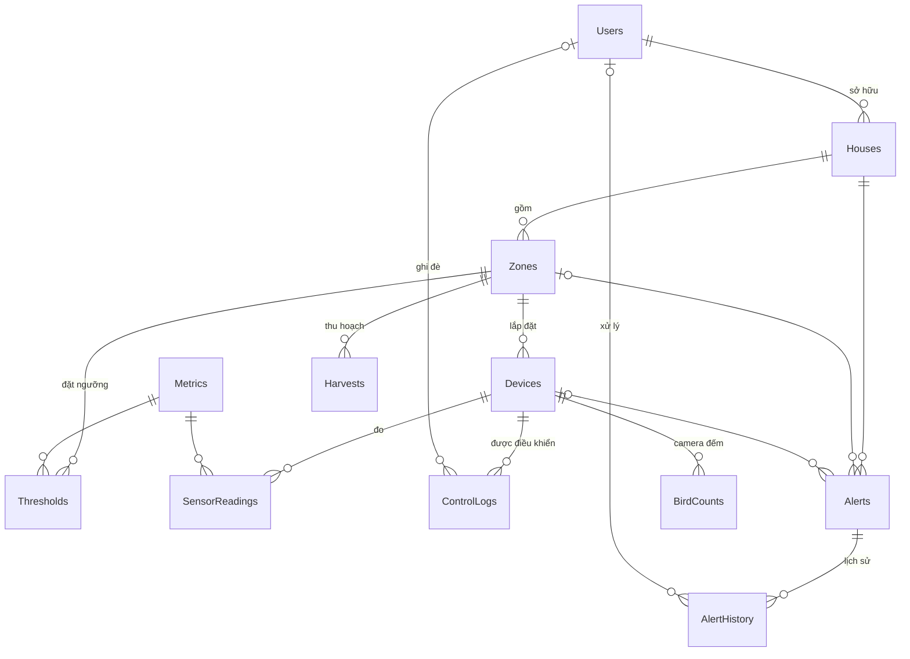

# SwiftletCare — Thiết kế CSDL SQL Server & hợp đồng tích hợp

- **Ngày:** 2026-10-12
- **Trạng thái:** Đang thiết kế (duyệt từng phần)
- **Nguồn yêu cầu:** [Project.md](../../../Project.md)

## Bối cảnh & mục tiêu

- Đề tài môn Hệ quản trị CSDL. Thầy chấm toàn bộ hệ thống: cả 6 nhiệm vụ phải demo end-to-end; phần SQL Server (thiết kế, SP, trigger, chỉ mục, phân quyền) được đầu tư sâu hơn.
- Nhóm 5 người, hạn 4 tuần (≈ 09/11/2026). Spec này chốt CSDL và các hợp đồng tích hợp sớm để các thành viên làm song song.
- Chức năng chia 3 mức: **Bắt buộc / Nên có / Nếu còn thời gian**. Trễ hạn thì cắt từ mức thấp nhất, không cắt nguyên một nhiệm vụ.
- Môi trường: SQL Server 2025 Express (hiện chỉ bật Windows authentication), Node 25, Python 3.13; chưa có Docker/Mosquitto.

## Phần 1 — Phân bổ logic & ranh giới Prisma / file .sql (đã duyệt)

### Phân bổ logic (phương án C — kết hợp)

| Việc | Đặt ở | Mức |
|---|---|---|
| Thu nhận lô dữ liệu cảm biến + mở/đóng cảnh báo ngưỡng trong 1 transaction | SP | Bắt buộc |
| Ghi đè thủ công: ghi trạng thái thiết bị + nhật ký điều khiển | SP | Bắt buộc |
| Ghi lịch sử cảnh báo | Trigger | Bắt buộc |
| Vài view báo cáo | View | Bắt buộc |
| Chỉ mục cho bảng SensorReadings | Prisma schema | Bắt buộc |
| Phân quyền | File .sql | Bắt buộc |
| Đếm chim theo cửa sổ thời gian | SP | Nên có |
| Chống báo trùng cảnh báo thiên địch | SP | Nên có |
| Sao lưu / phục hồi | File .sql | Nên có |
| Chỉ mục lọc | Migration viết tay | Nếu còn thời gian |
| Phân vùng bảng | Migration viết tay | Nếu còn thời gian |
| CRUD nhà, khu vực, thiết bị, người dùng, ngưỡng | Prisma | — |
| Vòng điều khiển PID, publish MQTT, WebSocket, gửi thông báo | Backend NestJS (không viết bằng T-SQL) | — |

### Nguồn định nghĩa schema

- **Bảng chỉ do Prisma schema định nghĩa và migrate** (một nơi duy nhất).
- Phần Prisma không biểu diễn được (ràng buộc CHECK, chỉ mục có INCLUDE, chỉ mục lọc, tạo bảng trên partition scheme) được **viết tay vào chính file migration**: `prisma migrate dev --create-only` → thêm SQL vào cuối `migration.sql` → áp dụng. Mọi DDL của bảng nằm trong `prisma/migrations/`, có phiên bản.
- Prisma không hỗ trợ enum trên SQL Server → các miền giá trị (Role, DeviceType, Status, AlertType, …) dùng ràng buộc CHECK theo cách trên.
- File `.sql` riêng chỉ chứa: SP, trigger, view, phân quyền, dữ liệu mẫu. Viết dạng `CREATE OR ALTER` để chạy lại an toàn.
- **Thứ tự triển khai:** `prisma migrate deploy` → các file `.sql` (view/SP/trigger, phân quyền) → dữ liệu mẫu.

### Gọi SP từ Prisma

- Không dùng TVP (Prisma không truyền được). SP nhận chuỗi JSON và đọc bằng `OPENJSON`:
  ```sql
  EXEC dbo.sp_IngestReadings @Json = N'[{"device":"H1-F1-SENSOR","metric":"TEMP","value":28.5,"at":"2026-10-12T10:40:00Z"}]';
  -- trong SP: SELECT ... FROM OPENJSON(@Json) WITH (device VARCHAR(50), metric VARCHAR(10), value DECIMAL(9,2), at DATETIME2(0))
  ```
- Backend gọi bằng `` prisma.$queryRaw`EXEC dbo.sp_IngestReadings @Json = ${JSON.stringify(batch)}` `` (tham số hóa, không nối chuỗi) hoặc `$executeRaw` khi không cần kết quả.
- **Quy ước:** mỗi SP trả về **tối đa một** tập kết quả.

## Phần 2 — ERD & danh sách bảng (đã duyệt)



### Bắt buộc (10 bảng)

| Bảng | Cột | Ràng buộc |
|---|---|---|
| **Users** | UserId, Username, PasswordHash, FullName, Email, Phone?, Role, IsActive, CreatedAt | UQ Username, UQ Email; CK Role ∈ {ADMIN, OWNER} |
| **Houses** | HouseId, OwnerId→Users, Name, Address?, IsActive, CreatedAt | UQ(OwnerId, Name) |
| **Zones** | ZoneId, HouseId→Houses, Name, FloorNo | UQ(HouseId, Name); FloorNo 0 = lối vào |
| **Devices** | DeviceId, ZoneId→Zones, Code, Name, DeviceType, Status, LastSeenAt?, Mode?, IsOn?, Level?, IsActive, CreatedAt | UQ Code (= MQTT client id); CK DeviceType ∈ {SENSOR, MIST, FAN, HEATER, SPEAKER, CAMERA}; CK Status ∈ {ONLINE, OFFLINE, ERROR}; CK Mode ∈ {AUTO, MANUAL}; CK Level 0–100; CK chỉ cơ cấu chấp hành (MIST/FAN/HEATER/SPEAKER) mới có Mode/IsOn, SENSOR/CAMERA thì Mode/IsOn/Level đều NULL |
| **Metrics** | MetricCode (PK), Name, Unit, ValidMin, ValidMax | Bảng tra: TEMP, HUMID, CO2, LIGHT; CK ValidMin < ValidMax; khoảng hợp lệ dùng lọc dữ liệu hỏng khi thu nhận |
| **Thresholds** | PK(ZoneId, MetricCode), MinValue?, MaxValue?, TargetValue?, UpdatedBy?→Users, UpdatedAt | CK có ít nhất một ngưỡng; CK Min < Max; CK Target ∈ [Min, Max] |
| **SensorReadings** | ReadingId (BIGINT), DeviceId, MetricCode, Value DECIMAL(9,2), RecordedAt | Xem chỉ mục bên dưới |
| **ControlLogs** | LogId, DeviceId, IsOn, Level?, Mode, Source, UserId?, Reason?, CreatedAt | CK Source ∈ {AUTO, MANUAL}; MANUAL ⇒ UserId NOT NULL |
| **Alerts** | AlertId, HouseId, ZoneId?, DeviceId?, AlertType, Severity, MetricCode?, Value?, DetectedClass?, Confidence?, SnapshotPath?, Message, Status, CreatedAt, ResolvedAt?, ResolvedBy? | CK AlertType ∈ {THRESHOLD, PREDATOR, DEVICE_OFFLINE, POPULATION_DROP}; CK Severity ∈ {INFO, WARNING, CRITICAL}; CK Status ∈ {NEW, ACK, RESOLVED}; RESOLVED ⇔ ResolvedAt NOT NULL; PREDATOR ⇒ có DetectedClass ∈ {rat, snake, owl}, Confidence ∈ [0,1], SnapshotPath; THRESHOLD ⇒ có ZoneId, MetricCode |
| **AlertHistory** | HistoryId, AlertId, OldStatus?, NewStatus, UserId?, Note?, ChangedAt | Do trigger ghi; UserId NULL = hệ thống |

### Nên có (2 bảng)

- **BirdCounts**: CountId, CameraId→Devices, WindowStart, InCount, OutCount. UQ(CameraId, WindowStart); CK số đếm ≥ 0. Chỉ lưu số tổng hợp theo cửa sổ 5 phút, không lưu video.
- **Harvests**: HarvestId, ZoneId, HarvestDate, NestCount, WeightGram, Grade?. UQ(ZoneId, HarvestDate); CK Grade ∈ {A, B, C}. Phục vụ báo cáo tương quan môi trường – sản lượng.

### Nếu còn thời gian

- **NestLogs** (nhật ký phát triển tổ yến theo tuần).

### Đã loại (YAGNI)

Tọa độ nhà yến; bảng thành viên nhà yến và vai trò VIEWER (chỉ còn ADMIN thấy tất cả, OWNER thấy nhà của mình); bảng lưu thông báo đã gửi; bảng phiên đăng nhập (dùng JWT).

### Chỉ mục SensorReadings (Bắt buộc, viết bằng Prisma)

- Khóa chính `ReadingId` **nonclustered**; **clustered index trên `RecordedAt`** — dữ liệu xếp theo thời gian, hợp truy vấn theo khoảng và dễ chuyển sang phân vùng.
- Chỉ mục `(DeviceId, MetricCode, RecordedAt, Value)` — `Value` là cột khóa thứ 4 thay cho `INCLUDE`, bao phủ tương đương nhưng Prisma biểu diễn được.
- Phụ thuộc R4 (thuộc tính `clustered` trong Prisma).

### Quyết định thiết kế

1. **`Alerts.HouseId` dư thừa có chủ ý** (không đạt 3NF chặt khi đã có ZoneId): cảnh báo giảm đàn là cấp nhà, không có khu vực; mọi truy vấn cảnh báo lọc theo nhà. SP đảm bảo HouseId khớp ZoneId. Ghi vào báo cáo như một đánh đổi.
2. **Mọi khóa ngoại `NO ACTION`**: nhà/thiết bị đã có lịch sử không xóa được, chỉ ngừng dùng (`IsActive = 0`). Bảo toàn lịch sử và tránh lỗi "multiple cascade paths" của SQL Server.

### Quy ước thời gian (UTC)

- Mọi cột thời gian là `DATETIME2(0)` lưu **UTC** (Prisma coi `DateTime` là UTC).
- Giá trị mặc định dùng `@default(dbgenerated("sysutcdatetime()"))`, **không** dùng `@default(now())` vì có thể sinh `CURRENT_TIMESTAMP` (giờ địa phương của server). Mọi SP/trigger dùng `SYSUTCDATETIME()`, không dùng `GETDATE()`/`SYSDATETIME()`.
- Simulator và mô-đun AI gửi ISO 8601 có hậu tố `Z` (VD `2026-10-12T10:40:00Z`).
- View/SP báo cáo theo ngày đổi sang giờ Việt Nam:
  `CAST(col AT TIME ZONE 'UTC' AT TIME ZONE 'SE Asia Standard Time' AS DATE)`.
- Khi **lọc** theo ngày Việt Nam, đổi mốc ngày sang UTC rồi so sánh trực tiếp với cột (giữ điều kiện SARGable để dùng được chỉ mục), không bọc cột bằng `AT TIME ZONE` trong `WHERE`.

## Rủi ro cần kiểm chứng

Kiểm chứng ở bước lập kế hoạch, trước khi triển khai phần liên quan.

| # | Rủi ro | Cách kiểm | Nếu xảy ra |
|---|---|---|---|
| R1 | Prisma `create`/`update` trên SQL Server sinh `OUTPUT INSERTED` không kèm `INTO`; SQL Server từ chối với bảng có trigger (`Alerts`, `Devices`). | Tạo bảng thử có trigger, gọi `prisma.x.create()` / `update()`. | Quy ước chỉ ghi các bảng có trigger qua SP. |
| R2 | Chỉ mục lọc / phân vùng viết tay trong migration bị `prisma migrate dev` coi là lệch (drift) so với schema. | Thêm chỉ mục lọc vào migration, chạy lại `prisma migrate dev`, xem có đòi reset không. | Đưa phần đó ra file `.sql` chạy sau migrate, ghi rõ ngoại lệ. |
| R3 | `$queryRaw` chỉ trả về tập kết quả đầu tiên của SP. | Gọi SP trả 2 tập kết quả từ Prisma. | Đã phòng sẵn bằng quy ước "một tập kết quả / SP". |
| R4 | Phiên bản Prisma đang dùng có thể không hỗ trợ thuộc tính `clustered` cho `@@id` / `@@index` trên SQL Server (cần cho chỉ mục SensorReadings). | Khai báo `@id(clustered: false)` + `@@index([recordedAt], clustered: true)`, chạy `prisma migrate dev --create-only`, xem SQL sinh ra. | Viết tay phần clustered/nonclustered vào file migration (theo cơ chế Phần 1). |
